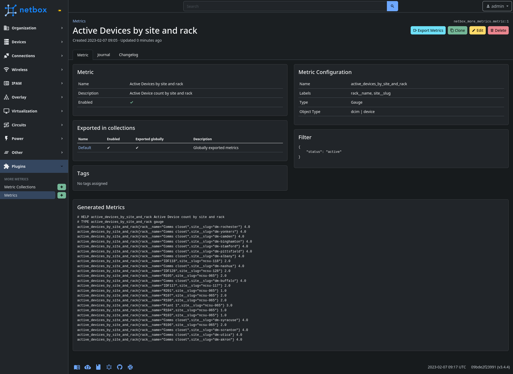
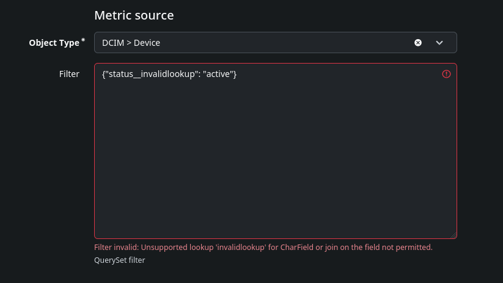

# netbox-more-metrics

Create custom metrics and export information from NetBox into your timeseries database.

## Compatibility

| NetBox Version | Plugin Version |
|----------------|----------------|
| 3.4 <= 3.7     | 0.1.X, 0.2.X   |
| 4.0 <= 4.5     | 0.3.X, 0.4.X   |

## Installing

For adding to a NetBox Docker setup see
[the general instructions for using netbox-docker with plugins](https://github.com/netbox-community/netbox-docker/wiki/Using-Netbox-Plugins).

### Install

```bash
pip install netbox-more-metrics
```

or by adding to your `local_requirements.txt` or `plugin_requirements.txt` (netbox-docker):

```bash
netbox-more-metrics
```

### Development Install

If you would like to install a version not yet published to pypi.

```bash
pip install git+https://github.com/TheDJVG/netbox-more-metrics
```

or by adding to your `local_requirements.txt` or `plugin_requirements.txt` (netbox-docker):

```bash
git+https://github.com/TheDJVG/netbox-more-metrics
```

### NetBox Configuration

Enable the plugin in `/opt/netbox/netbox/netbox/configuration.py`,
or if you use netbox-docker, your `/configuration/plugins.py` file :

```python
PLUGINS = [
    'netbox_more_metrics'
]
```

If you want to export the configured metrics without authentication set the plugin config `export_metrics_without_auth` to `True`.
By default, normal NetBox view permissions apply.
```python
PLUGINS_CONFIG = {
    'netbox_more_metrics' : {
        'export_metrics_without_auth': True
    }
}
```
## Features

### Custom metrics

For example, you could track the amount of active devices over time by rack and site:


- Export **Gauge**, **Counter**, and **Info** Prometheus metrics from NetBox models (DCIM, IPAM, Circuits, Virtualization, Tenancy, etc.).
- Group data by one or more model fields (`metric_labels`), including relational fields (`site__slug`, `rack__name`) and custom fields (`custom_field_data__my_field`), and rename exported labels cleanly via `label_renames`.
- Export either aggregated object **counts** (`count`) or built-in **utilization percentages**:
  - `dcim.Rack`: Space utilization (`get_utilization`) and power utilization (`get_power_utilization`)
  - `ipam.Prefix`: IP utilization (`get_utilization`)
  - `ipam.Aggregate`: Prefix utilization (`get_utilization`)
- Filter and exclude source querysets with Django ORM JSON dictionaries (`filter` and `exclude`).
- Full NetBox 4.x integration including UI & REST API `FilterSet`s, global search indexing, tags, custom fields, changelogs, and journals.

### Filter & security validation

Every filter, exclude rule, and label path is validated on save and when collectors initialize:


Sensitive authentication/credential models (such as `users` and `auth`) and ReDoS-prone regex lookups are automatically blocked from metric queries and relation traversals.

### Heavy lifting is done by the database

As much as possible is aggregated directly in PostgreSQL to take advantage of model indexes and database optimizations. `NULL` database values are exported as the string `"null"`.

## Endpoints

- **Global endpoint**: Collections with `include_in_default=True` are automatically registered in NetBox's global `/metrics` endpoint (when `METRICS_ENABLED=True`).
- **Per-collection & per-metric endpoints**: Enabled `MetricCollection`s (`/plugins/more-metrics/collections/<id>/metrics/`) and `Metric`s (`/plugins/more-metrics/metrics/<id>/metrics/`) can be scraped individually.

## Development & Testing

Start the local NetBox development environment with Docker Compose:

```bash
make start
```

Run the automated test suite inside the NetBox container:

```bash
docker compose run --rm netbox ./manage.py test netbox_more_metrics
```

To build and test against a specific NetBox 4.x version (e.g. `v4.2` or `v4.5`):

```bash
NETBOX_VER=v4.5 docker compose build --build-arg NETBOX_VER=v4.5 netbox
NETBOX_VER=v4.5 docker compose run --rm netbox ./manage.py test netbox_more_metrics
```

See [docs/netbox_upgrade_strategy.md](docs/netbox_upgrade_strategy.md) for details on CI matrix testing and maintaining compatibility with future NetBox releases.

## Future ideas

- Additional built-in utilization/capacity metrics (e.g. individual power feed capacity).

**More ideas welcome!**
